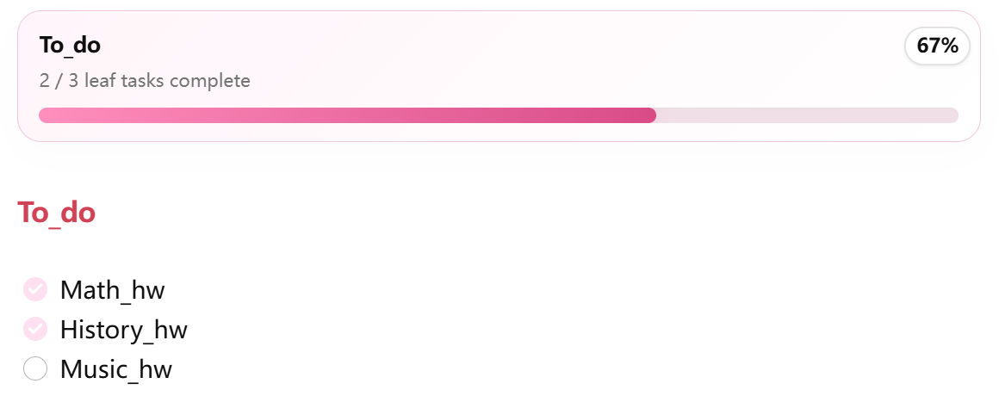

# Office Flow

Office Flow is a small personal Obsidian plugin for faster task notes and a softer workspace: inline task buttons, pretty progress cards, one-gesture archiving of temporary to-do lists, and two header shortcuts.



## Features

- **Task edit mode**: inline buttons after every unfinished task for child tasks, pen notes and top-level tasks, plus a category picker for empty tasks.
- **Progress cards**: `office-progress` code blocks render a progress card for a section of the current note or of another note.
- **Archive and restore**: hold a card's percent badge to move the section's tasks into today's archive file, and hold again there to bring them back.
- **Home and favorite buttons**: two header actions that open your Home note and a favorite note.
- **Pink sidebar**: optional soft pink sidebars and ribbons.

Plain Obsidian API, TypeScript and CSS. No external services, no extra libraries.

## Task edit mode

In editing mode every unfinished task (`- [ ]`) gets small buttons right after the checkbox:


| Button | Inserts below the task |
| --- | --- |
| `+` | an indented child task (`	- [ ] `) |
| `✎` | an indented pen note (`	🖊`) |
| `-` (child tasks only) | a new top-level task (`- [ ] `) |
| category picker (empty tasks only) | one of four labels as the task text |

Pen notes belong to the task above them, so new tasks are inserted after a task's pen notes, both from the buttons and when you press Enter on the task. Backspace on an empty inserted line removes that line again.

The four category labels default to Action, Research, Design and Code and can be changed in settings.

Commands: `Toggle task edit mode`, `Insert child task`, `Insert pen note`.

## Progress cards

Put an `office-progress` code block anywhere and list the sections to track, one per line.

A section of the current note:

````md
```office-progress
To_do
```
````

A section of another note, optionally with an alias that becomes the card title:

````md
```office-progress
[[Home 7_21|Work]] : Today's Tasks
[Everyday_Task] : Today's Tasks
```
````

A section is a heading whose text contains the given name, up to the next heading of the same or a higher level. The counter counts leaf tasks: a task that has child tasks is a group, not a task. Clicking the alias on a cross-note card opens that note.

## Archive and restore

A temporary to-do list is most useful when it can be cleared in one gesture but is still kept somewhere. On a card for a section of the current note, the percent badge is that gesture:

1. Click the percent. It turns into an archive icon (it reverts after 5 s, or on a short press).
2. Press and hold the icon for 2 s. A ring fills up, then everything under the heading (tasks, child tasks, pen notes, other blocks) moves to today's archive file. The heading and its `office-progress` block stay where they are.

Archived sections land in `archive/todo/2026_10_16_temp_todo.md`. Each archived block carries its own card and remembers where it came from:

````md
## 15:32 To_do
```office-progress
15:32 To_do
restore: [[study/Everyday_Task]] : To_do
```
- [ ] Music_hw
````

Inside the archive folder the badge is blue and works the other way round: hold it to move the block back under its original heading and remove it from the archive file. Notes inside the archive folder are never archived.

Both actions need the heading to match exactly one heading in the note; otherwise you get a notice and nothing is written. The archive file is written before the source is trimmed, so a failed step never loses tasks.

## Home and favorite buttons

Two actions appear at the top right of every Markdown view:

- **Home** opens the note set as *Home note* (default `Home`).
- **Heart** opens the note set as *Favorite note*. Right-click the heart to make the current note the favorite.

Commands: `Open Home note`, `Open favorite note`.

## Pink sidebar

Turns the left and right sidebars and ribbons a soft pink. Just a toggle.

## Settings

| Setting | Default | What it does |
| --- | --- | --- |
| Task edit mode | on | Show the inline task buttons and the Enter / Backspace helpers. |
| Category picker | on | Show the category labels on empty tasks. |
| Home button | on | Show the Home and heart actions in view headers. |
| Office progress blocks | on | Render `office-progress` code blocks. |
| Pink sidebar | on | Apply the pink sidebar style. |
| Home note | `Home` | Note opened by the Home action. |
| Favorite note | empty | Note opened by the heart action. |
| Archive folder | `archive/todo` | Where archived sections go. Cards inside it show the restore control. |
| Archive date format | `YYYY_MM_DD` | Moment.js format for the start of the archive file name. |
| Archive file name suffix | `temp_todo` | Literal text added after the date with an underscore. |
| Category 1 to 4 | Action, Research, Design, Code | Labels offered by the category picker. |

## Installation

1. Download `office-flow.zip` from the latest [release](https://github.com/dan9574/office-flow/releases/latest).
2. Extract it. You get an `office-flow` folder with `manifest.json`, `main.js` and `styles.css`.
3. In Obsidian open **Settings** → **Community plugins** → **Installed plugins** and click the **Open plugins folder** icon.
4. Move the `office-flow` folder into that plugins folder.
5. Restart Obsidian, go back to **Community plugins** and enable **Office Flow**.

The task buttons need Obsidian's editing mode (Live Preview or source). Progress cards also render in reading mode and inside other plugins that render Markdown, such as Always-on-Top Tasks.

---

## 安装指南

1. 从最新的 [Release](https://github.com/dan9574/office-flow/releases/latest) 页面下载 `office-flow.zip`。
2. 解压，得到包含 `manifest.json`、`main.js`、`styles.css` 的 `office-flow` 文件夹。
3. 打开 Obsidian **设置** → **第三方插件** → **已安装插件**，点击 **打开插件文件夹** 图标。
4. 把 `office-flow` 文件夹放进这个插件文件夹。
5. 重启 Obsidian，回到 **第三方插件** 设置页并启用 **Office Flow**。

## Development

```bash
npm install
npm run build
```

`npm run build` type-checks and bundles `src/main.ts` into `main.js`. To try a change, copy `manifest.json`, `main.js` and `styles.css` into `<vault>/.obsidian/plugins/office-flow/` and reload Obsidian. `npm run dev` rebuilds on every save.
